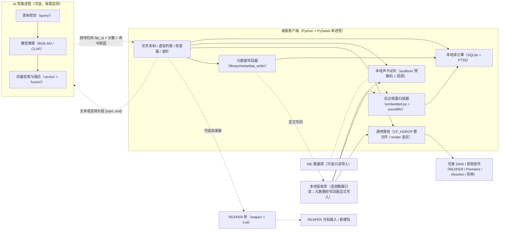

# AudioSearchTool 独立客户端重做设计方案

日期：2026-11-23
状态：设计已定稿（待确认开工 R1）

---

## 1. 定位

做一个**独立音效浏览器**，交互手感对标 REAPER Media Explorer（ME），**元数据管理对标 Soundminer**（字段编辑、批量处理、UCS 分类、规范写回源文件，并由 AI 辅助补全描述）；中文文本语义搜索与音频找同类作为**增强能力**接入，而不是整个应用的前提地基。

落地方式以**文件拖放**为通用路径，服务于 REAPER 及其他 DAW、视频剪辑软件（Premiere、DaVinci Resolve、剪映等）；REAPER 桥接适配器保留为可选的加速通道，不作为试听或浏览的前置依赖。

本方案取代 [音效语义搜索系统_方案与开发规划_v1.md](./音效语义搜索系统_方案与开发规划_v1.md) 的产品形态与阶段划分，并取代 [2026-11-20-独立播放与界面重做-design.md](./2026-11-20-独立播放与界面重做-design.md) 中通过本机 HTTP 获取目录浏览、搜索分页与波形的架构约定；该文档第 5 节（MediaEye 封面链）、第 6 节（暗色工作台视觉系统）与第 7 节（键盘与鼠标规格）由本方案继承。

---

## 2. 为什么重做

1. **地基顺序倒置**：此前先建设三路检索、公共契约、REAPER 桥接与验收体系，再补桌面浏览与本地试听，导致“快速浏览、按键即听、拖出落地”这一高频主循环长期缺失。
2. **浏览链路走 HTTP 不跟手**：现有桌面端所有查询、分页与波形读取都经由本机 HTTP（带会话令牌、8 秒超时、分页绑定 `query_id`）转发至后端服务，架构上难以达到本地数据库的即时过滤与虚拟滚动手感。
3. **ME 基础能力大面积缺失**：现有桌面端缺少文件夹树 / 数据库视图、多列排序与自定义列、收藏与标签、循环与变调 / 变速试听等日常浏览核心功能。
4. **工程与流程成本过重**：截至当前，仓库积累了约 110 份报告、约 4.96 万行测试代码（产品源码约 3.5 万行），而真实目录仅导入 18,483 条（全库约 113 万条，位于 F 盘），真实向量仅在 128 条样本上验证。流程证明成本远高于产品体验本身。

---

## 3. 功能对照表

| 功能 | REAPER Media Explorer (ME) | Soundminer（参考） | 当前现状 | 计划轮次 |
|---|---|---|---|---|
| 文件夹树 / 快捷方式 / 数据库视图 | 左侧树：文件夹、收藏路径、数据库 | 多库视图、分类树、智能筛选 | 无文件夹树与数据库视图 | R1（文件夹树）<br>R4（多库/快捷方式） |
| 路径栏与前进 / 后退 | 支持路径直达、历史前进/后退 | 路径与视图导航 | 无路径栏与导航历史 | R1 |
| 边打字过滤与搜索语法 | 即时过滤；支持空格 AND、`OR`、`NOT`/`-`、`"短语"`、`*` 通配符 | 即时全文检索 + 字段语法 | 需提交 HTTP 查询；规则 v2 支持排除项，不即时过滤 | R1（复刻 ME 即时过滤与完整语法） |
| 可排序 / 可配置列 | 点击列头排序；可显隐与重排常用字段列（名称、描述、时长、采样率、声道、位深、格式、大小、包、路径等） | 全字段可排序、列布局预设 | 仅固定 9 列，基本无排序（仅占位级调用） | R1（复刻 ME 常用列、排序与列宽/顺序调整）<br>R2/R4（列配置持久化） |
| 选中即播开关（Autoplay） | 工具栏开关；开启后切行自动从头播放 | 支持自动试听开关 | 上下键固定从 0 自动播，无切换开关 | R1（默认单击与上下键切行自动播）<br>R2（独立开关） |
| 空格播放 / 停止、单击/方向键切行、点波形定位 | 空格播/停、单击或上下键切行自动播、点波形定位 | 同类标准键盘试听 | 已通过本地声卡实现（`audition/` + `main_window.py`） | R1（改为直连本地解码；`Space` 暂停保留当前指针，再按从当前指针续播；不绑定 `←`/`→` 微移） |
| 拖选区、循环（Loop） | 波形拖选区；Loop 开关循环播放选区或整条 | 选区试听、Loop | 已有拖选区；无循环播放（Loop） | R2 |
| 音量、变调 / 变速试听 | 试听音量推子、Pitch 半音调节、Rate 速率调节 | 推子、Pitch / Varispeed | 无音量、变调、变速控制 | R2 |
| 按工程速度同步（Tempo Match） | 可按工程 BPM 匹配变速/对齐节拍 | ReWire / DAW 同步（部分版本） | 无 | 后续 / 可选 |
| 波形显示、缩放与峰值缓存 | 全宽/可调波形、滚轮缩放、`.reapeaks` 缓存 | 多分辨率高帧率波形缓存 | 已有滚轮缩放与双光标（蓝审听/琥珀播放头）；峰值经 HTTP 请求且无本地持久化缓存 | R1（基础波形）<br>R2（本地峰值缓存与缩放优化） |
| 整文件拖出 | 直接拖拽行到时间线 | 直接拖出原文件 | 已实现（`POST /materialize` + `CF_HDROP`） | R1（直拿本地路径拖出） |
| 选区拖出（渲染临时文件） | 从波形选区直接拖出渲染片段 | Spot / 拖出选区并可自动处理 | 已实现（仅 WAV，经 HTTP `materialize`） | R2（支持多格式本地渲染） |
| 落地时转码 / 改采样率 | 插入时按工程配置自动重采样 | 支持落地前转码、改采样率/位深（Transfer） | 无 | 后续可选 |
| 双击插入 DAW 光标处 / 新轨 | 双击或 Enter 插入选中轨或自动新建轨 | Spot 到 DAW | 已有 REAPER 桥插入到光标处及新建轨 | R6（作为加速器接入） |
| 收藏 / 标签 / 评分 / 搜索历史 | Favorites 快捷路径、自定义数据库字段 | 评分、Tag、Project、Bin | 仅搜索历史；无收藏、标签、评分 | R4 |
| 离线盘状态与重复文件 | 离线文件灰显/报错 | 离线盘标识、重复识别 | 已有离线灰显状态；无重复文件视图 | R1（离线标灰）<br>R4（重复管理） |
| 元数据编辑与源文件写回 | 可在列表内直接编辑部分元数据字段 | 完整字段编辑与 BWF / iXML / ID3 / Vorbis 写回 | 只读，无编辑 | R5：库内编辑 + 显式写回源文件（BWF `bext` / `LIST-INFO` / `iXML`，MP3 ID3，FLAC/OGG Vorbis comment），**同时兼容 Soundminer 与 REAPER ME 双端读取** |
| 列表内直接编辑与批量编辑 | 支持列表内直接编辑部分字段；无正则批量批改 | 列表内编辑 + 多选批量设值、追加、前置、查找替换、正则 | 无 | R5 |
| 按模板批量改名 | 无内置多字段模板批量改名 | 字段占位符模板改名，带预览与冲突处理 | 无 | R5（支持 UCS 等模板、预览、重名检测、可撤销） |
| UCS 分类管理 | 无原生 UCS 面板（可借外部脚本/字段） | 原生 UCS `CatID` / `Category` / `SubCategory` 与文件名反解析 | 无 | R5（选择校验 + 从 UCS 文件名反解析字段） |
| CSV 导入导出元数据 | 可借助脚本导出/导入部分字段 | 完整元数据表格导出/导入与映射 | 无 | R5（支持导出表格批量修改后再导回） |
| AI 元数据自动补全 | 无 | 无 | 无 | R5（依赖 R3：CLAP 零样本 UCS 建议、生成描述/关键词、中英互译） |
| 文本语义搜索与音频找同类 | 无（纯字符串与通配符匹配） | 需第三方或高阶版本有限相似 | 已有 BGE-M3 + CLAP + RRF（仅 128 条真实向量验证） | R3 |
| 相关度排序与命中原因 | 无 | 无明确命中解释 | 已有来源标识与 explanation 面板 | R3 |

---

## 4. 架构

### 4.1 总体架构

浏览器主体回归**桌面单进程**，直连本地 SQLite + FTS5 与本地文件系统；AI 推理与向量索引拆成**可选的独立旁路进程**。浏览、过滤、试听与文件拖出全链路不再经过 HTTP。



### 4.2 核心模块边界

- **桌面单进程（PySide6 Qt Widgets）**：
  - `QTableView` 搭配虚拟化 `QAbstractTableModel`，只读取与渲染当前视口可见行及少量预取窗；排序、过滤、文件夹切换全部下沉到 SQLite 查询与索引。
  - 本机试听直接读取本地文件路径并复用 `audition/`，彻底去掉音频字节经 HTTP 搬运的开销。
- **素材库（`library/`）**：
  - 用户在界面中添加文件夹（或根目录）后，后台扫描器执行增量扫描（支持暂停 / 续跑），对不可达根路径或磁盘离线状态显式标灰。
  - 内嵌元数据（`bext` / `LIST-INFO` / `iXML`）解析复用 `catalog/embedded.py`；基础音频流信息（采样率、声道数、位深、时长）用 `soundfile`（辅以 `wav.py`）读取。
  - 为桌面浏览器单独设计本地 SQLite schema（目录根、文件、文件夹聚合、元数据字段、FTS5 全文索引、波形峰值缓存、用户收藏/标签/备注、写回批次日志），**不再沿用**现有的 `manifest.json` + `roots.local.json` + `revision` 导入流程。
  - **元数据模型**：所有界面编辑先落在本地工具库中，每个字段记录来源（`embedded` / `user` / `ai` / `imported_me`）与脏标记（`dirty`）；用户随时可继续整理与检索，只有在触发显式的“写入文件”操作时才批量落盘到源文件。
  - 文件保留基于规范化路径 + `(size, mtime_ns)` 的稳定 `file_id` / 内容版本，供 AI 旁路进程与本地缓存引用。
  - 可选提供**只读导入 ME 数据库**（`.ReaperFileList`）功能，直接继承已有描述与标签，不修改 ME 原库文件。开发期全部库文件、缓存与临时渲染产物置于 `.local/`。
- **AI 旁路进程（`ai/`）**：
  - 复用 `inference/`、`retrieval/`（含 `vector/`、`fusion/`、`query/`）与 `indexing/` 的核心能力，对桌面侧只暴露一个窄接口：输入「中文/英文查询文本，或参考音频路径 + `[start, end)` 秒」，返回「排序后的 `file_id` 列表 + 相关度分数 + 命中原因」。
  - 通过薄适配层将新本地库记录映射给现有检索/编码组件，不强制桌面依赖 `contracts/models.py` 的 HTTP 分页契约。
  - AI 进程未启动、模型未下载或向量尚未建全时，浏览器所有本地浏览、过滤、试听与拖放功能保持 **100% 可用**，状态栏明确展示 AI 状态（未启动 / 加载中 / 就绪 / 覆盖率）。
- **落地路径**：
  - **整文件拖放**：拿到本地真实路径直接发起 Windows `CF_HDROP`，通吃 REAPER、Ableton、Cubase、Premiere、DaVinci Resolve、剪映等任何支持文件拖入的软件。
  - **选区拖放**：将 `[start, end)` 渲染为临时 WAV（置于 `.local/` 临时渲染目录并做数量/启动清理）后以 `CF_HDROP` 拖出。
  - **DAW 适配器**：REAPER 复用现有文件通道桥与 Lua 脚本，作为“双击 / `Enter` 插入到编辑光标处（无选中轨则新建轨）”的加速器；其他 DAW 适配器后续按实际需求再补。

### 4.3 性能目标与音频线程约束

> 以下为设计目标值，将在 **R1 首周完成本机实测** 并根据实测结果微调索引或实现方案：

| 指标 | 目标值 | 约束条件 |
|---|---|---|
| 边打字过滤响应 | `< 100 ms` | 100 万行库规模下，FTS5 查询 + 虚拟列表刷新 |
| 方向键切行到出声 | `< 80 ms` | 本地常见短音效（WAV/FLAC），含预解码与流切换 |
| 冷启动到可操作 | `< 3 s` | 不含 AI 模型加载；打开窗口即可浏览、过滤与试听 |

**Python 音频回调硬约束**：
- 解码与重采样必须放在工作线程（`QThreadPool`）中完成，产出连续 `float32` 缓冲（`PlaybackBuffer`）后再交由音频线程消费；**禁止在 PortAudio 回调内做文件 I/O、格式解码、重采样或复杂 Python 对象分配**，避免 GIL 竞争导致爆音（xrun）或卡顿。
- 播放头位置由音频回调实际交付的帧数递增计算，保持精确可信，不做定时器估算。

### 4.4 元数据写回安全

为确保写回元数据不破坏任何音频资产，写回模块必须严格执行以下安全规则：

1. **音频数据永不修改**：写回操作只重建或更新元数据块（chunk / tag），写前与写后各计算一次音频数据块（如 WAV `data` chunk）的哈希；若前后哈希不一致则立即中止并自动回滚。
2. **原子替换与未知块保留**：先在源文件同盘目录下写入临时文件，校验通过后再通过 `os.replace` 原子替换原文件；WAV 等容器内所有未知 chunk 必须原样按原顺序保留。
3. **写前备份与按批次撤销**：每个文件执行写回前，先将原元数据块与关键属性备份至 `.local/metadata-backups/`，并在数据库记录写回批次（`write_batches`），支持按批次一键撤销回原状态。
4. **Dry-run 预览与异常拦截**：正式写入前先展示预览清单（涉及文件数、逐字段修改前后差异）；离线路径或只读文件自动跳过并单独列出。
5. **与现有环境协同边界**：
   - 元数据写回会更新源文件的 `mtime`，F→G 镜像同步脚本（`sfx-f-to-g-v2.cmd`）会将这些文件识别为增量变化并同步复制，属预期行为；
   - REAPER Media Explorer 维护独立的元数据缓存，源文件写回后需要在 ME 中执行重新扫描才能刷新显示；
   - 写回格式与字段映射**同时兼容 Soundminer 与 REAPER ME 双端读取**（标准 BWF `bext` + `LIST-INFO` + `iXML`、MP3 ID3、FLAC/OGG Vorbis comment），双端字段优先级与私有扩展映射在 R5 开工前通过实测确认。

---

## 5. 复用与冻结清单

### 5.1 复用与重构策略

| 现有模块 | 处置方式 | 说明 |
|---|---|---|
| `catalog/embedded.py` | **只读复用** | 纯标准库实现，完整支持 WAV `bext` / `LIST-INFO` / `iXML` 读取；写回器（`library/metadata_writer.py`）单独新写，仅复用其 chunk 解析结构。 |
| `audition/player.py`、`sink.py` | **直接复用** | 帧计数驱动播放头、`SoundDeviceSink` 设备容错与 `CallbackStop` 停流逻辑已稳定。 |
| `audition/covers.py` | **直接复用** | 已完整移植 MediaEye 封面链与目录级缓存。 |
| `audition/buffer.py` | **小改复用** | 当前仅接受 `bytes` 且上限 120 s；改为直接支持文件路径流/读取并配合工作线程预解码（长文件分段策略在 R2 深化）。 |
| `audition/render.py` | **R2 扩展复用** | 当前仅通过 `audioio/decode.py` 支持 WAV 选区渲染；R2 改为 `soundfile` 以支持 AIF / FLAC / MP3 等格式的选区拖出。 |
| `audioio/resample.py`、`wav.py` | **直接复用** | 保留 `polyphase-v2` 重采样与 WAV 头解析；`audioio/waveform.py` 依赖 `ManifestCatalog`，新浏览器不走该入口，改为独立的本地峰值生成器与磁盘缓存。 |
| `desktop/theme.py`、`file_drag.py`、`waveform_view.py` | **借鉴重写** | 保留暗色色板、双光标（蓝审听 / 琥珀播放头）与拖放交互；重写时剥离 `contracts.models` 与 HTTP 客户端依赖，接入本地峰值缓存。 |
| `inference/`、`retrieval/`、`indexing/` | **R3 旁路复用** | 保留 BGE-M3 / CLAP 编码、RRF 融合与规则 v2；`retrievers.py` 依赖 `ManifestCatalog`、`text_encoder.py` 依赖 `AssetRecord`，R3 接入时补一层薄适配器对接新库字段。 |
| `integrations/reaper/`、`reaper/audiosearch_bridge.lua` | **R6 复用** | 保留文件通道协议、安全守卫与 Lua 桥脚本，仅作为可选的 REAPER 光标插入加速器。 |

新增外部依赖说明：R5 元数据写回需要引入 `mutagen`（用于 MP3 ID3 与 FLAC / OGG Vorbis comment 标签读写），按项目规则通过 `uv.lock` 统一锁定。

### 5.2 冻结清单

以下模块与流程在本方案实施期间**冻结不再演进**，待新浏览器在对应轮次完全替代其功能后再行清理删除：
- 现 `desktop/`（`main_window.py`、`client.py`、`commands.py`、`state.py`、`explanation*`、`feedback*` 等）；
- 现 `startup/` 启动器与 `service/` 公共 HTTP 服务；
- `contracts/` 中与浏览分页、波形、试听、命令回执相关的 HTTP 契约；
- `integration/` 的 manifest 导入与同步服务链路；
- `evaluation/`（9,643 行离线检索评测工具）。

### 5.3 代码组织与分支策略

- **打标冻结**：在旧架构起点打 tag `legacy-alpha-011`，保留完整的旧架构与历史报告快照。
- **主线推进与精简**：打标后直接在 `main` 主线推进并清理已淘汰的旧模块与临时目录；新代码按三块清晰边界组织：
  - `src/audiosearch/library/`：文件夹管理、增量扫描、SQLite + FTS5 查询、峰值与元数据缓存、ME 数据库只读导入，以及 R5 的 `metadata_writer.py` 与 UCS 分类表数据（UCS 官方分类表具体版本及是否含中文翻译在 R5 前核实）；
  - `src/audiosearch/browser/`：独立 PySide6 桌面客户端（文件夹树、虚拟列表、检查器、波形、试听控制与拖放）；
  - `src/audiosearch/ai/`：可选 AI 旁路进程及对新库字段的薄适配层。
- **渐进清理**：旧模块在新模块完成对应轮次验收后再删除；仓库根目录的测试残留目录（如 `quality010-world-*`）在开工 R1 时一并清理。

---

## 6. 轮次计划

每一轮的固定交付物为：**一个可直接启动试用的版本 + 一页简明试用说明 + 用户上手验收**，不以内部测试指标或书面报告替代真人使用体验。


### 6.1 轮次总表

| 轮次 | 核心内容 | 你的验收标准 |
|---|---|---|
| **R1 浏览器骨架** | 添加文件夹并后台增量扫描、左侧文件夹树、路径栏与前进/后退、虚拟列表（可排序、可调列）、边打字即时过滤、选中即播（Space / ↑↓ / 点波形）、整文件拖出、基础检查器与封面 | 在 1.8 万条测试库与 113 万条全库上，日常搜与听的手感接近 ME |
| **R2 试听深化** | 波形拖选区、Loop 循环开关、试听音量、Pitch 变调与 Rate 变速、自动播放开关、波形多分辨率缩放与本地峰值缓存、多格式选区渲染拖出 | 日常挑声音、裁片段、听效果不再需要切回 ME |
| **R3 AI 接入** | 中文自然语言语义搜索、从文件或波形选区“找同类”、结果表相关度列与命中原因、全库文本/音频向量后台建库与覆盖率显示 | 用中文找抽象情绪或声音质感，比纯关键词明显更快 |
| **R4 素材库管理** | 收藏、标签、评分、备注（收藏 / 评分 / 备注存在工具库；需要入文件的字段在 R5 写回）、搜索历史、多库与快捷方式、离线盘状态管理、重复文件识别 | 具备独立音效库日常整理与沉淀能力 |
| **R5 元数据管理（Soundminer 级）** | 列表内直接编辑与多选批量编辑（设值 / 追加 / 前置 / 查找替换 / 正则）、模板批量改名（预览、重名检测、撤销）、UCS 分类与文件名反解析、CSV 导入导出、AI 补全建议（零样本 UCS 建议 / 描述生成 / 中英互译，支持逐条确认或批量采纳）、显式写回源文件与批次撤销 | 不再需要打开 Soundminer 整理元数据；写回后 ME 与 Soundminer 能读到；音频数据哈希不变 |
| **R6 落地与发行** | 接回 REAPER 适配器（双击/Enter 插入光标与新建轨）、在 Premiere / Resolve / 剪映等验证拖放、PyInstaller 独立安装包（含 PortAudio/libsndfile DLL） | 可打包给其他 Windows 机器直接安装使用 |

---

### 6.2 R1 可开工详细设计（浏览器骨架）

#### A. 界面布局

继承 2026-11-20 设计的暗色冷灰工作台色板（`#12151A` 画布 / `#1A1E25` 面板 / `#5B93D6` 选中蓝 / `#EE9B2E` 播放琥珀）与字体规则（正文 `Segoe UI` + `Microsoft YaHei UI`，数字列 `Cascadia Mono`），在其三区布局基础上增加左侧文件夹导航与顶部路径栏：

```text
┌──────────────────────────────────────────────────────────────────────────────┐
│ [◀][▶][▲] 路径栏：F:\SFX\Magic\...              [+ 添加文件夹]  扫描进度/状态 │
│ ⌕ 搜索音效（边打字即时过滤：空格AND / OR / NOT,- / "短语" / *）    1,137,204 条 │
├───────────────┬─────────────────────────────────────────┬────────────────────┤
│ 文件夹树       │ 名称 描述 时长 采样率 声道 位深 格式 大小 包 │  ┌──────────────┐  │
│ ▾ F:\SFX      │ ─────────────────────────────────────── │  │ 封面 240×240 │  │
│   ▸ Magic     │ ▌whoosh_01 ... 1.80s 96k 2ch 24b WAV 1M │  └──────────────┘  │
│   ▸ UI        │  whoosh_02 ... 1.40s 96k 2ch 24b WAV 1M │   whoosh_01        │
│   ▸ Foley     │  cast_03   ... 3.20s 48k 2ch 24b WAV 2M │   路径 / 包 / 格式  │
│  [离线盘灰显]  │ …（QTableView 虚拟滚动，行高 28px）       │   内嵌 BWF/iXML 描述 │
├───────────────┴─────────────────────────────────────────┴────────────────────┤
│ ▐▓▓▓▓▓▓▓▓▓▓▓▓▓▓▓▓▒▒▒▒▒▒▒▒▒░░░░░░░░░░░░░░░░░░░░░░░░░░░░░░░░░░░░░░░░░░░░░░░░░░ │
│ 0:00                           0:00.721                              0:01.800 │
├──────────────────────────────────────────────────────────────────────────────┤
│ 1,137,204 条 · 当前目录 3,420 条 · 声卡就绪 (48kHz) · 本地库直连               │
└──────────────────────────────────────────────────────────────────────────────┘
```

- 四块主体以 `QSplitter` 分隔并记忆尺寸：左侧文件夹树（可折叠）、中间虚拟结果表（默认复刻 ME 常用列：名称 `Filename`、描述 `Description/Comment`、时长 `Length`、采样率 `Sample Rate`、声道 `Channels`、位深 `Bit Depth`、格式 `Type/Ext`、文件大小 `Size`、素材包/厂牌 `Package/Folder`、路径 `Path`；支持点击列头排序及列宽/顺序调整）、右侧检查器（封面 + 元数据详情，可折叠）、底部全宽基础波形与状态栏。

#### B. 键位与鼠标规范（R1 首版）

继承 2026-11-20 设计 §7 的键盘鼠标框架，R1 落地的操作规格如下：

| 触发 | 行为 | 备注 |
|---|---|---|
| `Space` | 播放 / 暂停；暂停保留当前播放指针，再次按下从当前指针处续播 | 搜索框聚焦时必须输入空格，不触发播放；输入法组字期间不拦截 |
| `↑` / `↓` | 切换上一行 / 下一行并从头自动播放 | 焦点在列表时生效 |
| `Esc` | 停止播放（R2 增加先清除选区） | — |
| `Ctrl+F` | 聚焦搜索框并全选已有文本 | — |
| `Alt+←` / `Alt+→` | 文件夹浏览历史后退 / 前进 | 同 Windows 资源管理器 / ME 习惯 |
| 列表单击 / 拖拽 | 单击某行即选中并从头自动播放；拖拽直接拖出原文件（`CF_HDROP`） | R1 仅整文件拖出；R2 增加 Autoplay 开关 |
| 列表右键 | 在资源管理器中打开所在目录 / 复制文件名 / 复制完整路径 | — |
| 波形单击 | 定位并从该位置开始播放 | R1 先做基础峰值绘制与点击定位 |

注：不绑定 `←` / `→` 播放头微移。

#### C. 本地库 SQLite Schema 草案（`.local/library.sqlite3`）

使用 SQLite WAL 模式，与旧 `catalog` 表结构彻底解耦：

- `roots`：`id`, `path`, `label`, `is_online`, `last_scan_at`, `scan_cursor`, `status`（`idle`/`scanning`/`paused`/`offline`）
- `folders`：`id`, `root_id`, `parent_id`, `rel_path`, `name`, `file_count`（支撑左侧树毫秒级展开，无需全表 `GROUP BY`）
- `files`：`id`（稳定主键）, `root_id`, `folder_id`, `rel_path`, `filename`, `ext`, `size_bytes`, `mtime_ns`, `duration_sec`, `sample_rate`, `channels`, `bit_depth`, `package`, `description`, `bext_json`, `ixml_json`, `is_available`, `indexed_at`
- `files_fts`（FTS5 虚表，unicode61 + 前缀索引 `prefix='2 3'`）：`filename`, `rel_path`, `package`, `description`, `embedded_text`，触发器与 `files` 同步
- `waveform_cache`（R1 可先内存 LRU，R2 落盘）：`file_id`, `mtime_ns`, `peaks_blob`, `points`
- `user_meta`（R4 启用）：`file_id`, `favorite`, `rating`, `tags_json`, `note`, `updated_at`
- `metadata_fields`（为 R5 预留结构；R1 先只写入 `source = 'embedded'` 的扫描字段）：`file_id`, `field`, `value`, `source`（`embedded`/`user`/`ai`/`imported_me`）, `dirty`, `updated_at`
- `write_batches`（R5 启用，用于写回审计与按批次撤销）：`batch_id`, `created_at`, `file_count`, `backup_dir`, `status`（`pending`/`committed`/`reverted`/`failed`）

#### D. 扫描与过滤策略

- **增量扫描**：按目录树广度优先遍历，比对 `(rel_path, size_bytes, mtime_ns)`；未变化文件跳过解码与元数据解析，新增/修改文件每 200 条批量写入一个事务，避免锁住前台读取（WAL 模式下读不阻塞写）。
- **离线检测**：扫描或读取前先检查 `roots.path` 可达性；磁盘未挂载时仅标记该 `root.is_online = 0`，不删除已索引记录，列表中对离线行置灰显示。
- **边打字过滤与默认列**：搜索框输入加 `80~120 ms` 轻防抖后在工作线程执行 SQLite 查询，结果以行 ID 列表或分页游标回到主线程刷新 `QAbstractTableModel`；检索语法复刻 ME，支持 `空格`（AND）、`OR`、`NOT` 或 `-词`（排除）、`"词组"`（精确短语）及 `*` 通配符（前缀/包含匹配）。默认展示 ME 常用列（名称、描述、时长、采样率、声道、位深、格式、文件大小、素材包/厂牌、路径）并支持列头排序与列宽/顺序调整；当前文件夹选中时默认限定在该目录子树内（可一键切换“全局 / 当前文件夹”）。

#### E. R1 验收清单

1. 添加一个包含 1.8 万条真实音效的目录，后台扫描可暂停/续跑，过程中界面不卡死。
2. 再挂载 F 盘全库（约 113 万条），记录冷启动耗时、全量扫描耗时与内存占用。
3. 在 100 万级数据下：切换左侧文件夹、点击各列排序、边打字过滤，验证 `< 100 ms` 过滤响应目标。
4. 方向键连按、空格播停、点击波形定位，验证 `< 80 ms` 出声目标及无爆音。
5. 直接从列表把文件拖入 REAPER（及其他已装软件如剪映/视频工具）时间线成功落地。
6. 拔掉/模拟离线根盘时，界面明确灰显且不报错崩溃、不丢历史记录。

---

## 7. 开发与协作流程

- **精简协作**：取消多 Agent 分工、任务卡与逐阶段审计报告体系；只保留对核心行为（如数据库增量更新、FTS 解析、音频缓冲边界、拖放路径生成）的自动化行为测试，不写只检查源码字符串的测试。
- **反馈驱动**：每轮交付可直接运行的桌面启动命令与一页试用说明，以你在真实工作流中的使用体感作为进入下一轮的唯一准入标准。
- **文档同步时机**：待本方案审阅确认后，再同步更新 `AGENTS.md` 与 `README.md` 中的项目定位、模块归属与启动方式；同时将 `AGENTS.md` 中“源音频只读”规则修订为“音频数据永不修改；元数据仅在用户显式写回操作下由写回模块写入”。

---

## 8. 风险与待定

1. **PySide6 下百万行列表与音频回调实测**：`QTableView` 配合 SQLite 在 113 万行排序/滚动时的真实延迟、以及 Python 音频回调在高负载扫描下的防爆音表现，需在 **R1 首周实测**；若发现 Python 回调或 Qt 模型存在明确瓶颈，届时再评估局部原生扩展（如 Rust/Cython 音频核心）。
2. **113 万条全库首次扫描耗时**：F 盘为 USB 简单存储空间，全量打开读取头信息与 WAV chunk 可能需要较长 IO 时间，需在 R1 做好断点续扫、IO 并发度节流与进度预估，避免拖慢磁盘。
3. **AI 检索质量基线**：现有语义与音频检索质量仅在有限小样本（128 条真实向量 / 6 条查询）上有验证记录；R3 接入全库时需同步观察真实全库下的召回与相关性表现，必要时再调整特征或重排权重。
4. **元数据写回损坏文件的风险**：修改容器 chunk 或标签存在结构损坏风险；通过音频数据块写前后哈希校验 + 自动回滚、未知 chunk 原样保留、同盘临时文件 + `os.replace` 原子替换、以及 `.local/metadata-backups/` 写前备份四重机制兜底。
5. **大批量写回对 USB 存储池的 IO 压力与断电风险**：万级以上文件批量改写对外接盘 IO 负担较重，若中途断电可能留下半途批次；需依托写前备份、原子替换与 `write_batches` 批次状态日志做断点清理或整批回滚。
6. **Soundminer 与 REAPER ME 双端写回字段映射及 ME 缓存刷新**：WAV `bext` / `LIST-INFO` / `iXML`、ID3 与 Vorbis comment 在 Soundminer 与 REAPER ME 双端的字段优先级和私有扩展存在差异，且 ME 依赖自有缓存需重新扫描；双端兼容映射细节需在 R5 开工前实测确认。
