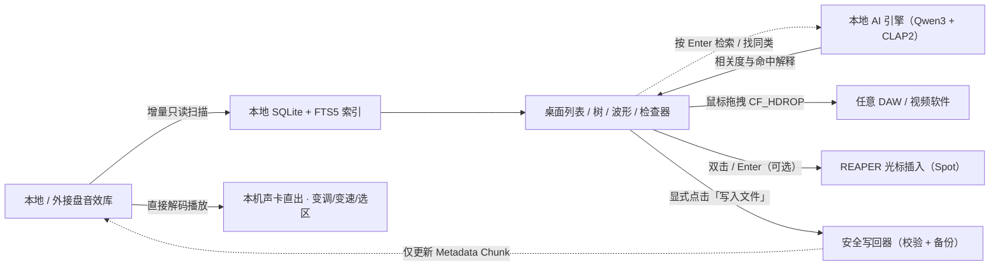
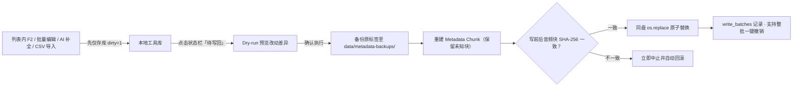

# Whistle 快速上手指南

独立桌面音效浏览器，兼具 **REAPER Media Explorer 的浏览试听手感**、**Soundminer 级的元数据整理写回能力**，以及 **Qwen3 + CLAP2 本地 AI 中文语义检索与找同类**。

---

## 1. 工作原理与核心数据流



- **音频样本默认只读**：日常加收藏、写备注、甚至编辑描述和 UCS 分类，全都只先保存在本地工具库（SQLite）里，**不会改动原音频文件**。
- **离线可用**：即使没有安装模型或还没跑 AI 向量索引，关键词检索、目录浏览、声卡试听、拖放、REAPER Spot 和元数据编辑全部正常可用。

---

## 2. 安装与开箱准备（独立便携版）

将 `Whistle` 压缩包解压到本地磁盘任意目录（不要放在只读系统目录或权限受限文件夹）：

```text
Whistle/
  Whistle.exe               <-- 双击直接启动
  portable.flag             <-- 便携模式标记（数据存放在本目录 data\ 下）
  app_patch/                <-- （可选）在线热更新自动生成的代码补丁目录
  data/                     <-- 首次启动后自动生成（数据库、设置、临时渲染、写回备份）
  models/hf/                <-- （可选）离线 AI 模型缓存目录（包含 hub\）
  _internal/                <-- Python、PySide6、PortAudio、CUDA 等运行库
```

### 配置 AI 模型（任选一种）
1. **联网自动下载**：首次点击「AI 建库」或启用 AI 语义检索时，程序会自动从 HuggingFace 拉取模型；国内网络可配置环境变量 `HF_ENDPOINT=https://hf-mirror.com`。
2. **离线放置模型包**：将包含 `hub/`（内含 `Qwen/Qwen3-Embedding-0.6B` 与 `laion/clap2-large-audioxl-s1B`）的缓存目录复制到 `Whistle/models/hf/`，或设置环境变量 `AUDIOSEARCH_MODELS_DIR` 指向本机已有模型缓存目录。

---

## 3. 界面分区与布局

1. **顶部工具栏**：后退 / 前进 / 上一级导航、路径栏、`关键词 | ✦ AI 语义` 切换开关、搜索输入框、筛选栏开关、「+ 添加文件夹」、检查器折叠开关。
2. **左侧导航栏**：上方为视图区（全部素材、我的收藏、最近试听、重复文件、我的合集分组），下方为 `本地目录` 文件夹树（支持独立折叠，右键可重扫、重定位或加入合集）。
3. **中间虚拟列表**：支持百万级素材流畅滚动、点击列头排序、列宽/列顺序拖拽、`波形` 缩略图（可选 Spectral Peaks 频谱着色）、`★` 收藏与 `Mark` 已听标记。
4. **右侧检查器**：目录封面图、技术规格胶囊、在线状态、可展开的备注框，以及内嵌元数据清单与 **「编辑元数据 / UCS…」** 入口。
5. **底部波形与试听条**：自动播放 / 循环 / 保留音高 / 切行重置 / 拖出应用 / Spectral 开关，`音量`、`变调`、`变速` 无极旋钮，全宽交互波形与状态栏。

---

## 4. 添加音效库与日常检索

1. **导入目录**：点击右上 **「+ 添加文件夹」** 选择本地盘或外接盘根目录（如外接总库盘）。后台增量扫描不卡界面，可随时 **「暂停扫描 / 继续扫描」**，重扫会自动跳过未变动文件并保留你待写回的编辑。
2. **关键词即时过滤（支持 REAPER ME 语法）**：
   - `空格`：同时满足（AND），如 `fire whoosh`
   - `OR`：满足其一，如 `sword OR blade`
   - `-词` 或 `NOT 词`：排除，如 `magic -loop`
   - `"短语"`：精确匹配引号内文本
   - `*`：通配符，如 `UI_*_hit`
3. **AI 语义检索与以音找音**：
   - 切到 **`✦ AI 语义`** 模式后，支持中文自然语言描述和 `-排除`（如 `清脆金币奖励`、`沉重金属关门 -科幻`），按 **`Enter`** 或点击 **「检索」** 执行；点击左侧其它文件夹/页签时只切目录不自动重跑搜索，方便先选范围再按 `Enter`。
   - 选中某条声音或拖选底部波形片段后，右键 **「以该音频找同类 (AI)」**，可从整条或片段出发搜索声学相似素材。
   - **建库**：右下角点击 **「AI 建库」**，后台在独显上增量构建向量索引并实时显示覆盖率，可随时暂停续跑。

---

## 5. 试听、波形选区与高频快捷键

| 操作 / 键位 | 行为说明 |
|---|---|
| `Space` | 播放 / 暂停（保留当前指针，再按从指针处续播；搜索框聚焦时不拦截） |
| `↑` / `↓` | 切换上/下一行（开启自动播放时从头播放） |
| `Esc` | 有蓝色选区时先清选区；无选区时停止播放 |
| `Enter` / 双击文件行 | 当 REAPER 已连接时，非破坏性插入 REAPER 当前光标处（支持多选连续插入） |
| `F2` | 在列表内直接编辑当前行的「描述」或「素材包」字段 |
| `Ctrl+F` | 聚焦搜索框并全选已有关键词 |
| `Alt+←` / `Alt+→` / `Backspace` | 目录历史后退 / 前进 / 返回上一级文件夹 |
| 上下拖动旋钮 + `Shift` | 无极调整 `音量` / `变调` / `变速`；按住 `Shift` 精度微调；双击旋钮归零 |
| 波形左键拖拽 / 边缘 `↔` | 建立蓝色选区 `[start, end)` / 拖动选区左右边缘微调时长 |
| 从选区中部拖拽（+ `Alt`） | 导出选区片段 WAV 拖入 DAW；按住 `Alt` 额外加 `5 ms` 首尾淡入淡出 |
| 滚轮 / 中键拖动 / 双击波形 | 以光标为中心缩放 / 放大后平移 / 复位全长波形 |

---

## 6. REAPER 一键桥接与落轨

1. **一键安装桥接脚本**：点击底部状态栏 **`REAPER 未连接`** 打开配置弹窗，软件会自动识别默认安装或便携版目录（含 `reaper.ini` 的目录），点击 **「一键安装 / 更新脚本」** 即可部署 `audiosearch_spot_bridge.lua` 并安全追加到 `__startup.lua`（不覆盖原有的其他启动脚本）。也可在 REAPER 弹窗或左侧目录区一键导入 REAPER Media Explorer 快捷方式分组（只读解析 `reaper.ini`）。
2. **加载生效**：若 REAPER 已打开，重启 REAPER（自启加载）或在 REAPER 中按 `?` 打开 Actions → `New action...` → `Load ReaScript...` 选中脚本运行一次；底部状态栏变绿显示 **`REAPER 已连接 · <目标轨>`** 后即上线。
3. **无破坏插入（Spot）**：
   - **单条 / 波形选区**：按 `Enter` 或双击文件行，将原音频无破坏插入当前选中轨道的光标处（无选中轨时自动新建轨），并自动后移光标；底部有蓝色选区时仅裁切选区时段，且保留前后余量可在 REAPER 里继续拉长边缘；若开启了 **「应用调音」**，变调/变速/保留音高参数会一并无损写入 REAPER Take 属性。
   - **多选连续插入**：选中多条音效按 `Enter`（或右键 **「连续插入 REAPER 光标处」**），按顺序逐条顺排铺上时间线。
   - **通用拖拽**：即使未连接 REAPER，也随时可以从列表或波形选区直接拖入 REAPER 轨道或工程时间线。

---

## 7. Soundminer 级元数据整理、改名与安全写回



- **单条与批量编辑**：右键 **「元数据」** 或检查器点 **「编辑元数据 / UCS 分类…」**，内置 180+ 条 UCS v8.2 中英分类速查，支持从标准 UCS 文件名反解析字段；多选时支持批量设值、前置、追加、查找替换、正则表达式。
- **AI 辅助整理**：右键 **「元数据 → AI 自动补全 UCS / 描述 / 翻译…」**，可结合 CLAP2 声学零样本推荐 UCS `CatID`、补全描述并执行离线音效词库中英互译，支持按条勾选后批量写入库。
- **模板批量改名**：支持 `{CatID}_{FXName}_{Designer}` 等占位符、大小写/空格策略、重名冲突自动编号、环状改名两阶段无损交换，以及改名批次一键撤销。
- **CSV 协同**：支持导出 UTF-8-BOM CSV（Excel 直接打开不乱码），在 Excel 批量整理后再按 `file_id` / 路径安全导回。
- **写回兼容提示**：显式执行写盘后会更新文件 `mtime`，REAPER Media Explorer 需执行一次重新扫描刷新缓存，之后 REAPER ME 与 Soundminer 双端均可直接读取写入的 `bext` / `LIST-INFO` / `iXML` / ID3 / Vorbis 标签。

---

## 8. 在线增量热更新

- 便携版每次启动时会自动静默检查 GitHub Releases（`Echo722/Whistle`）是否有新版本发布，无需每次重新下载整包运行时。
- 发现可用更新后，状态栏版本号（如 `v0.1.0`）会提示可升级版本；点击即可下载 `< 1 MB` 的代码补丁包并原地重启升级，仅更新 `app_patch/`，**不覆盖** `data/` 本地数据库与 `models/` 模型缓存。
- 若新补丁首次启动异常，内置启动保护会在下次启动时自动回滚到上一个可用状态，确保工具可稳定打开。

---

## 9. 常见问题速查

| 现象 | 排查与处理 |
|---|---|
| 拖放进 REAPER 没反应，或日志提示写入 `inbox` `PermissionError` | 确认两个软件都在普通（Medium）权限下启动：不要一边用管理员运行 REAPER、另一边用普通权限打开浏览器，也不要让 `.venv\Scripts\python.exe` 带有低完整性标签。 |
| REAPER 打开一直卡在 `Initializing Main Window...` | 常见于 Win11 的系统 **「Windows MIDI 服务」（`midisrv` / `MidiSrv.exe`）** 在 USB 声卡/MIDI 设备休眠后僵死。在任务管理器结束卡住的 `reaper.exe` 与 `MidiSrv.exe`（或在 `services.msc` 重启「Windows MIDI 服务」）后重开 REAPER 即可恢复。 |
| 修改了 REAPER 桥接脚本目录提示 `[WinError 5] 拒绝访问` | 目标目录受终端安全策略或系统权限保护时，点击弹窗里的 **「打开脚本目录」** 或 **「复制脚本路径」** 手动把 `audiosearch_spot_bridge.lua` 拷入 `REAPER\Scripts\` 即可。 |
| 切换外接声卡或拔掉存储盘 | 试听模块支持在状态栏或切行时自动恢复声卡输出流；外接磁盘拔出后界面会灰显已索引文件而不丢任何收藏/笔记，插回后右键文件夹点重新扫描即可恢复。 |
